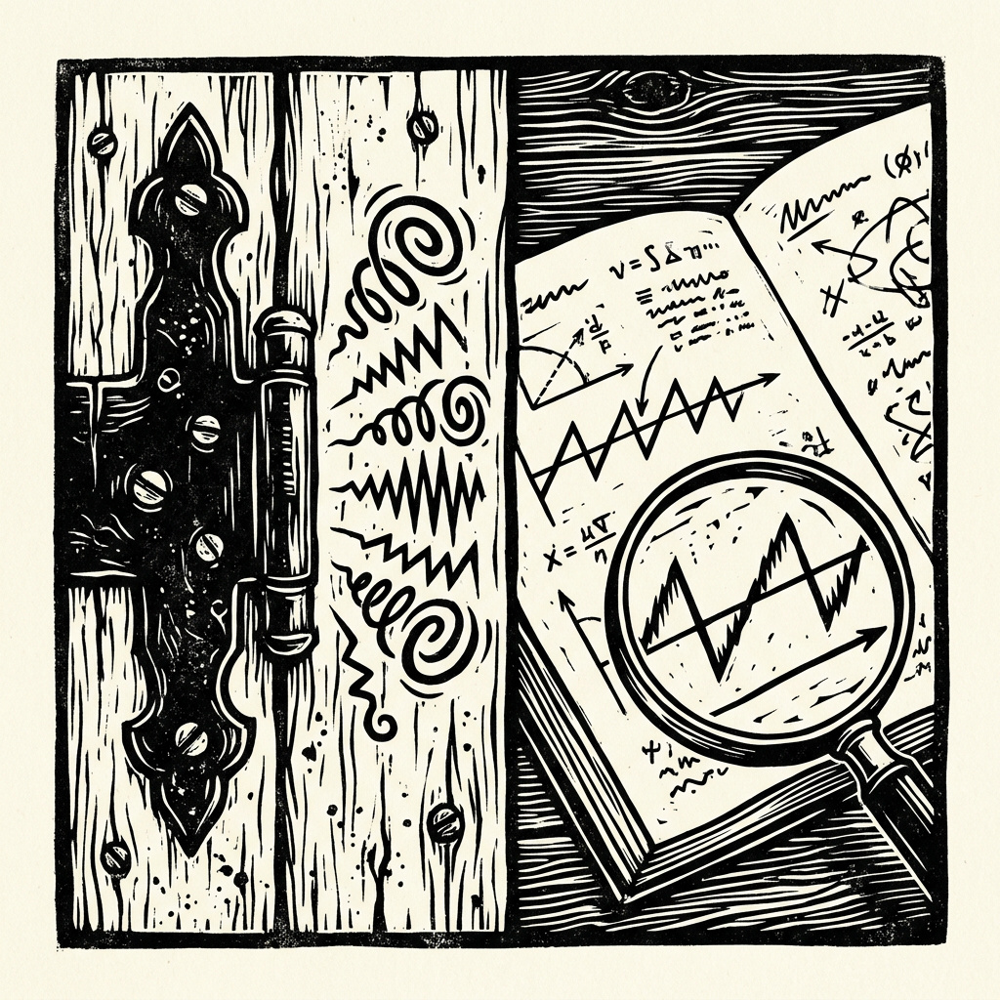

# Text-to-SFX Generation (Procedural Audio)

Sound effects generated by code instead of AI models. AI coding agents research how a sound is
physically made and write the code that synthesizes it; the code uses only math (oscillators,
noise, filters, physical models), so it needs no AI, GPU or model weights at runtime. Every
sound it produces is MIT-licensed and usable commercially, unlike the output of "open"
text-to-audio models released under non-commercial (CC-BY-NC) licenses.

**Live demo:** https://softwarewrighter.github.io/text-to-sfx-gen/


## Summary

| | When | Agent | Result |
|---|---|---|---|
| **First attempt** ([details](docs/phase1.md)) | 2026-02 | [opencode](https://opencode.ai) with GLM-4.7 | Python generators for 10 sound effects. Simple sounds (impacts, clicks, sirens) work; door sounds didn't. |
| **Second attempt** (below) | 2026-10 | [Claude Code](https://claude.com/claude-code) with Claude Opus 5.5 | A squeaky hinge built from research and measurements: a physics model with a slider UI, analysis of 23 real squeaks, and resyntheses that capture what real squeaks sound like. |

Status and what remains: [docs/phases.md](docs/phases.md).

## The squeaky hinge

<a href="https://blog.softwarewrighter.com/2026/10/29/ai-tools-domain-expert-skill/"></a>

**1. Research.** A hinge squeaks through stick-slip friction: the pin sticks, force builds up,
it slips, and the cycle repeats. When the slips lock to a resonance of the metal, their
repetition rate is the pitch you hear; when they don't, you hear separate creak clicks. Sources,
equations and pitfalls: [docs/domain-expertise.md](docs/domain-expertise.md), produced with the
`domain-expert` skill (see the blog post
[AI Tools #8: A Domain-Expert Skill Restarts a Stuck Project](https://blog.softwarewrighter.com/2026/10/29/ai-tools-domain-expert-skill/)).

**2. A physics model.** [Hinge Lab](hinge-lab/README.md) (Rust) simulates that friction with
sliders, re-rendering in about 0.1 s. Same parameters and seed always give the same sound. It is
physically right but sounded too smooth: one gliding tone with few overtones.


**3. Measuring real squeaks.** `tools/squeak_analysis.py` analyzed 23 squeaks from a
[reference video](https://www.youtube.com/watch?v=TspuiaFX2YQ). Real squeaks are sequences of
parts: steady pitches with sudden jumps, glides, and clean stretches that break into clicks, all
driven by sharp slip pulses that make them bright. Rebuilding each squeak that way from the
measurements reproduces these features. These rebuilds are the second-attempt sounds on the demo.


**Next:** rebuild Hinge Lab around this sequence-of-parts structure, so analyzed squeaks can be
loaded and edited, and an LLM can write new ones from a text description.

The reference audio is not in this repo or on the demo site (unclear provenance). It stays in
the gitignored `references/` folder; the published analysis shows only spectrograms and
measurements, with links to timestamps in the video.

## Quick start

```bash
uv venv && uv pip install numpy sounddevice matplotlib   # Python tools
cd hinge-lab && cargo run --release                      # Hinge Lab UI
```

```bash
# Hinge Lab CLI: render, then reproduce exactly from the saved JSON
cargo run --release -- render --preset squeaky --out s.wav
cargo run --release -- render --params s.json --out again.wav

# Analyze your own recording (mono, 44.1 kHz) into an HTML report
ffmpeg -i recording.wav -ac 1 -ar 44100 mono.wav
.venv/bin/python tools/squeak_analysis.py mono.wav out/
```

First-attempt generators and trainer: see [docs/phase1.md](docs/phase1.md).

## Demo site

`tools/build_site.sh` builds `site/`: first-attempt players, second-attempt players, and a
Details section linking to the full analysis (no reference audio) and the physics model. It
needs the local reference recording, so it runs on a developer machine.
`tools/publish_site.sh` pushes it to the `gh-pages` branch.

## Documentation

- [docs/explain.md](docs/explain.md): plain-language guide to what each file does (creates,
  saves, plays or graphs audio)
- [docs/phase1.md](docs/phase1.md): first attempt (generators, trainer, sound list)
- [docs/domain-expertise.md](docs/domain-expertise.md): friction-acoustics research briefing
- [docs/phases.md](docs/phases.md): status and remaining work
- [docs/blog-outline.md](docs/blog-outline.md): blog post outline
- [hinge-lab/README.md](hinge-lab/README.md): Hinge Lab UI and CLI

## Project structure

```
├── hinge-lab/                Rust physics model: UI and CLI
├── tools/                    squeak_analysis.py, build_site.sh, build_page.py, publish_site.sh
├── *_generator.py, sfx_trainer.py, play_3d_audio.py   First attempt (Python)
├── demos/                    Original demo page (+ demos/hinge: Hinge Lab renders)
├── site-src/                 Demo site stylesheet
├── docs/                     Research, status, phase 1 details, blog outline
├── images/                   Screenshots and figures
└── references/               Local reference recordings (gitignored, not redistributed)
```

## Acknowledgments

- **opencode** with **GLM-4.7**: first-attempt code generation
- **Claude Code** with **Claude Opus 5.5** (Anthropic): research, Hinge Lab, analysis tooling
  and demo site
- **Adnan Akay; Federico Avanzini, Stefania Serafin and Davide Rocchesso; Andy Farnell**: the
  friction-sound research and techniques the squeaky hinge builds on
- **Foley artists and sound designers**, whose techniques inform the procedural approaches

## Links

- Live demo: [softwarewrighter.github.io/text-to-sfx-gen](https://softwarewrighter.github.io/text-to-sfx-gen/)
- Related blog post: [AI Tools #8: A Domain-Expert Skill Restarts a Stuck Project](https://blog.softwarewrighter.com/2026/10/29/ai-tools-domain-expert-skill/)
- Blog: [Software Wrighter Lab](https://software-wrighter-lab.github.io/)
- Discord: [Join the community](https://discord.com/invite/Ctzk5uHggZ)
- YouTube: [Software Wrighter](https://www.youtube.com/@SoftwareWrighter)

## Copyright

Copyright (c) 2026 Michael A Wright

## License

MIT. See [`LICENSE`](LICENSE) and [`COPYRIGHT`](COPYRIGHT).

The reference recording analyzed for the squeaky hinge is not part of this repository and is
not covered by this license.
