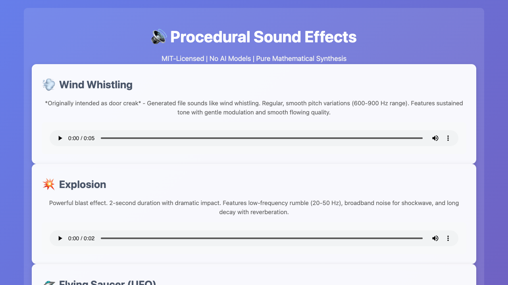
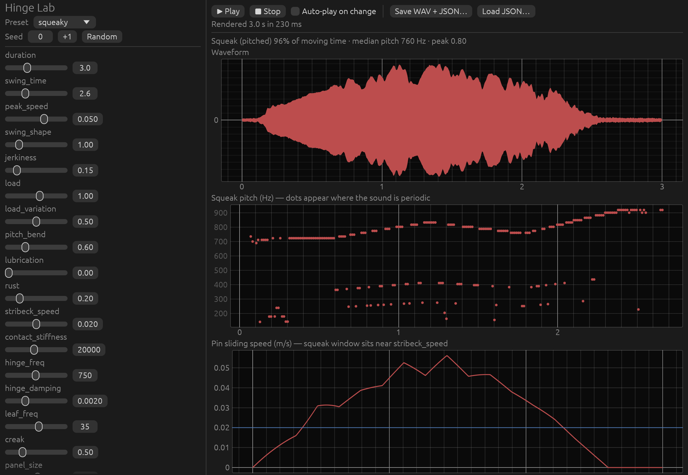
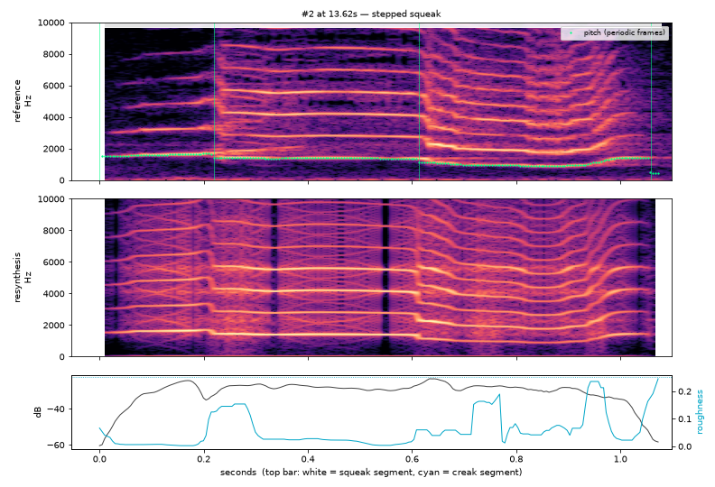
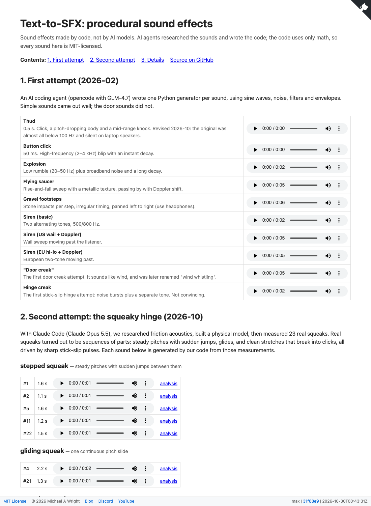

# Text-to-SFX Generation (Procedural Audio)

Sound effects generated by code instead of AI models. AI coding agents do the research and
write the synthesis code; the code itself uses only math (oscillators, noise, filters,
physical models), so it needs no AI, GPU or model weights at runtime. The output is
MIT-licensed and usable commercially. This makes it an alternative to "open" text-to-audio
models released under non-commercial (CC-BY-NC) licenses, at the cost of more effort per sound.

**Live demo:** https://softwarewrighter.github.io/text-to-sfx-gen/ (built by
`tools/build_site.sh`)

The project has two phases, each built with a different AI coding agent:

| Phase | When | Agent | What |
|---|---|---|---|
| [Phase 1](#phase-1-ai-written-procedural-generators) | 2026-02 | [opencode](https://opencode.ai) with GLM-4.7 ([Z.ai Coding Plan](https://z.ai/subscribe)) | Python/numpy generators for 10 sound effects, interactive trainer, demo page |
| [Phase 2](#phase-2-research-driven-squeaky-hinge) | 2026-10 | [Claude Code](https://claude.com/claude-code) with Claude Opus 5.5 | Friction-acoustics research, Rust physical model with slider UI (Hinge Lab), analysis of real squeaks, segment-based resynthesis, live demo site |

See [docs/phases.md](docs/phases.md) for status and what remains in each phase.

## Why this approach?

Many "open" audio models use CC-BY-NC licenses, which forbid commercial use. Instead of
generating audio with a model, we use AI to:

1. Research and understand the acoustics of a sound
2. Analyze how foley artists and sound designers create it
3. Write code that synthesizes it procedurally, with no AI at runtime
4. Iterate on listening feedback (and, in Phase 2, on measurements of real recordings)

**Advantages:** MIT license; no model downloads; runs on any CPU; fully parameterized;
reproducible (same parameters and seed give the same sound).

**Limitations:** lower quality than sample libraries or large models; more effort per sound;
limited to sounds we can model.

## Getting started

```bash
# Python (Phase 1 generators, analysis tool)
uv venv
uv pip install numpy sounddevice matplotlib

# Rust (Phase 2 Hinge Lab)
cd hinge-lab && cargo build --release
```

Run Python with `.venv/bin/python` (or `source .venv/bin/activate`).

---

## Phase 1: AI-written procedural generators



[opencode](https://opencode.ai) with GLM-4.7 wrote a Python script per sound effect. Each
script uses pure mathematical synthesis (sine waves, noise, filters, envelopes) and writes a
WAV file. The [session transcript](session-ses_3ba5.md) shows the interactive development.

### Sound effects

| Sound | Generator | Features |
|-------|-----------|----------|
| **Thud** | `thud_generator.py` | Low-frequency oscillator, filtered noise, fast attack |
| **Button Click** | `button_click_generator.py` | High frequency (2–4 kHz), sharp attack, immediate decay |
| **Wind Whistling** | `wind_whistling_generator.py` | Pitch variations (600–900 Hz), smooth flow. The Phase 1 demo page labels this "door creak" (an early door creak attempt that sounded like wind) |
| **Explosion** | `explosion_generator.py` | Low rumble (20–50 Hz), broadband noise, long decay |
| **Gravel Footsteps** | `gravel_footsteps_generator.py` | 6-second sequence, irregular timing, 3D spatialization, multi-band filtering |
| **Siren (Basic)** | `siren_generator.py` | 500/800 Hz alternating, 2.5 Hz cycle |
| **Siren (US Wail, EU Hi-Lo, US Yelp)** | `siren_3d_generator.py` | Sweeps and alternating tones with Doppler and radial velocity |
| **Siren (Realistic US Wail)** | `siren_realistic_generator.py` | Odd harmonics, tremolo, smoother sweep |
| **Flying Saucer** | `flying_saucer_generator.py` | 200–800 Hz rise-fall sweep, metallic texture, Doppler |
| **Hinge Creak** | `hinge_creak_generator.py` | First stick-slip attempt (superseded by Phase 2) |

```bash
.venv/bin/python thud_generator.py
afplay thud.wav                               # macOS
.venv/bin/python play_3d_audio.py gravel_footsteps.wav   # use headphones for 3D
```

WAV files are written to the project root (gitignored). The Phase 1 demo page is
`demos/index.html`; its `*.wav` entries are symlinks to the root files.

### Interactive trainer

`sfx_trainer.py` generates 4 variations, plays them, and lets you pick the best (0–3), regenerate
(r), or tweak parameters first. It saves the winner as `{sound_name}_final.wav`.

```bash
.venv/bin/python sfx_trainer.py
```

### Phase 1 docs

- [docs/research-findings.md](docs/research-findings.md): audio synthesis research
- [3D_AUDIO_README.md](3D_AUDIO_README.md): 3D spatial audio techniques

---

## Phase 2: research-driven squeaky hinge

Phase 1's door creak never sounded right. Phase 2 started over from the physics.

### 1. Research

A sourced briefing on friction acoustics: [docs/domain-expertise.md](docs/domain-expertise.md).
In short, a hinge squeaks through **stick-slip friction**. When the slip pulses lock to a
resonance of the metal (mode lock-in), their repetition rate is the pitch you hear. When they
don't lock, you hear separate creak clicks. Squeaking happens only within a window of load and
speed, and oil removes it. Main sources: Akay, *Acoustics of friction* (JASA 2002); Avanzini,
Serafin & Rocchesso, elasto-plastic friction (DAFx-02); Farnell, *Designing Sound* (2010).

### 2. Hinge Lab (Rust)



[hinge-lab/](hinge-lab/README.md) is an egui app and CLI. It simulates elasto-plastic friction
driving hinge and door-leaf modes, radiated through a wood panel and door frame. Sliders
re-render in about 0.1 s. Every render can be saved as WAV plus a JSON file that reproduces it
bit-for-bit.

```bash
cd hinge-lab
cargo run --release                                        # UI
cargo run --release -- render --preset squeaky --out s.wav # CLI
cargo run --release -- render --params s.json --out again.wav
```

It behaves correctly physically (squeaks only inside the speed window, oil silences them), but
it doesn't sound like a real door: one smooth, slowly gliding tone with few overtones.

### 3. Measuring real squeaks



`tools/squeak_analysis.py` splits a recording into events, tracks pitch and roughness, cuts each
event into parts, categorizes it, rebuilds it from slip pulses, and writes an HTML report.
Running it on a reference video ([Squeaky Door Hinge Opening Sound Effects, SoundEffectsFactory](https://www.youtube.com/watch?v=TspuiaFX2YQ))
found 23 squeaks in five categories (stepped squeak, gliding squeak, squeak → creak, creak /
ratchet, low groan) and showed what Hinge Lab was missing:

1. **Several parts per squeak.** The pitch jumps abruptly between steady plateaus.
2. **Brightness.** 6–10 strong harmonics from sharp slip pulses, not a smooth vibration.
3. **Smooth and rough parts alternate.** Squeaks break into creak clicks that slow down.

A resynthesis that follows each event's parts with sharp slip pulses reproduces these features.

```bash
ffmpeg -i recording.wav -ac 1 -ar 44100 mono.wav
.venv/bin/python tools/squeak_analysis.py mono.wav out/   # open out/index.html
```

**About the reference audio:** its provenance is unclear, so it is not in this repo or on the
demo site. It lives only in the gitignored `references/` folder. The published analysis shows
spectrograms and measurements, links each event to its timestamp in the video, and plays only
our resyntheses (`--no-reference-audio --source-url ...`).

---

## Demo site



`tools/build_site.sh` builds `site/` as one main page (`tools/build_page.py`):

1. **First attempt:** players for the Phase 1 generators
2. **Second attempt:** players for the 23 squeak resyntheses, grouped by category
3. **Details:** the reference source link, then short summaries linking to the full analysis
   (`analysis/index.html`, publish mode, no reference audio), the physics model
   (`hinge-lab.html`), the research briefing, and status

It needs the local reference recording, so it runs on a developer machine.
`tools/publish_site.sh` pushes the result to the `gh-pages` branch.

## Project structure

```
├── *_generator.py, sfx_trainer.py, play_3d_audio.py   Phase 1 (Python)
├── demos/                    Phase 1 demo page (+ demos/hinge: Hinge Lab renders)
├── hinge-lab/                Phase 2 Rust app and CLI
├── tools/                    squeak_analysis.py, build_site.sh
├── site-src/                 Hand-written pages for the demo site
├── docs/                     Research, briefing, phases/status, blog outline
├── images/                   Screenshots and figures
└── references/               Local reference recordings (gitignored, not redistributed)
```

## License

MIT License. See [LICENSE](LICENSE). Use in commercial projects, modify, redistribute;
attribution appreciated but not required. The reference recording analyzed in Phase 2 is not
part of this repository and is not covered by this license.

## Acknowledgments

- **opencode** with **GLM-4.7**: Phase 1 code generation
- **Claude Code** with **Claude Opus 5.5** (Anthropic): Phase 2 research, Hinge Lab, analysis
  tooling and demo site
- **Adnan Akay; Federico Avanzini, Stefania Serafin and Davide Rocchesso; Andy Farnell**: the
  friction-sound research and techniques Phase 2 builds on
- **Foley artists and sound designers**, whose techniques inform the procedural approaches
